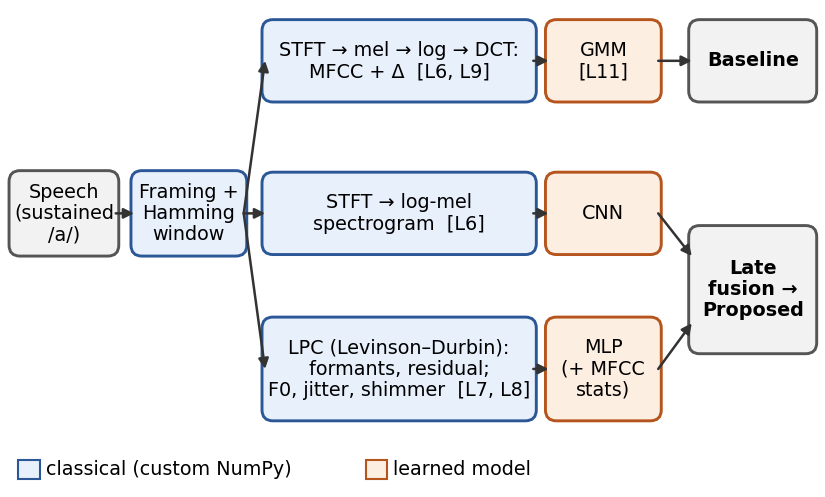

# Voice Pathology Detection — Hybrid Classical–Neural Pipeline

CS 568 Speech Processing (TED University) term project — Mustafa Mert Süerkan.

A non-invasive screening system that labels a sustained /a/ recording as **healthy** or
**pathological**. Classical speech analysis is implemented from scratch (STFT, MFCC, LPC,
F0/jitter/shimmer) and combined with a small CNN in a late-fusion model. An MFCC–GMM classifier
is the baseline. Training uses the Saarbrücken Voice Database (SVD) with speaker-independent
folds; the VOICED database is a fully external test set.

Proposal: [`docs/proposal/proposal.pdf`](docs/proposal/proposal.pdf)



## Status

- [ ] Front end: `stft.py`, `mfcc.py`, `lpc.py`, `perturbation.py` (all tests in `tests/` pass)
- [ ] SVD download, `.nsp` → `.wav`, `data/svd.py` index
- [ ] Speaker-independent folds, metrics
- [ ] GMM baseline (P1)
- [ ] CNN, MLP, late fusion, ablations (P1, P4)
- [ ] Cross-database test on VOICED (P2), per-sex analysis (P3)
- [ ] Final paper and presentation

## Setup

```bash
pip install -r requirements.txt
pip install -e .
pytest
```

All tests fail with `NotImplementedError` until the corresponding TODOs are filled in. The
librosa-based tests are skipped when librosa is not installed.

## Project layout

```
src/vpd/
  config.py              default parameters (Sec. IV of the proposal)
  features/stft.py       pre-emphasis, framing, Hamming window, STFT        (L6)
  features/mfcc.py       mel filterbank, log-mel, DCT-II, MFCC, deltas      (L6, L9)
  features/lpc.py        autocorrelation, Levinson–Durbin, residual, formants (L7)
  features/perturbation.py  F0 (autocorrelation), jitter, shimmer            (L8)
  data/svd.py, voiced.py dataset indexes
  data/splits.py         speaker-independent stratified folds
  eval/metrics.py        UAR, sensitivity, specificity, F1
  models/gmm_baseline.py MFCC–GMM baseline                                   (L11)
  models/fusion.py       CNN + MLP late fusion
tests/                   unit tests for every hand-written block
data/README.md           how to obtain the data
docs/proposal/           proposal (LaTeX source, figure, PDF)
```

## Evaluation protocols

- **P1:** speaker-independent stratified 5-fold cross-validation on SVD.
- **P2:** train on SVD resampled to 8 kHz, test on VOICED without fine-tuning.
- **P3:** results by sex, plus a sex-balanced training run.
- **P4:** ablations (CNN only, envelope features, source features, full fusion).

Primary metric: unweighted average recall (UAR). Also reported: F1, sensitivity, specificity, and ROC AUC.

## Data

See [`data/README.md`](data/README.md). Audio files are not stored in this repository.

## License

Code: MIT (see `LICENSE`). The datasets keep their own licenses (SVD: CC BY 4.0; VOICED: ODC-By 1.0).
